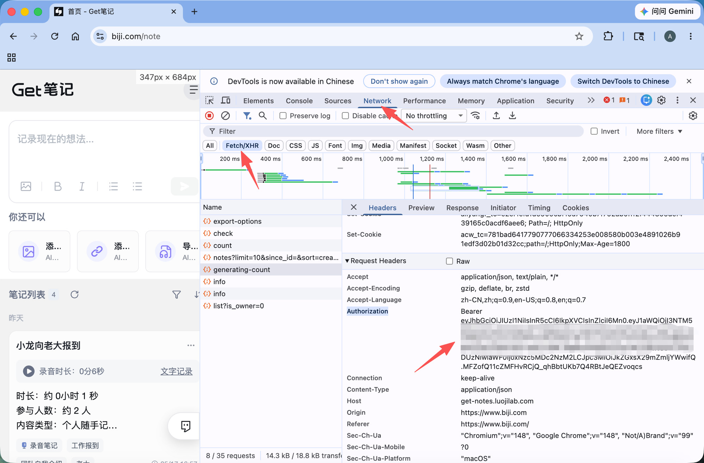

# Web 模式 Token 指南

Web 模式适合无法使用 得到大脑 OpenAPI 的用户。它复用浏览器里已经登录的 得到大脑网页版会话，所以只需要浏览器请求里的 `Authorization` header，不需要 `Client ID`。

## 什么时候用

适合使用 Web 模式的情况：

- 你的账号无法使用 OpenAPI。
- `测试连接` 提示当前账号无法使用所需的 OpenAPI 功能。
- 你可以在 `https://www.biji.com/note` 正常登录 得到大脑网页版。

如果你已经有可用的 `gk_...` OpenAPI Token 和 `Client ID`，优先使用 OpenAPI 模式。

## 桌面端自动获取（推荐）

1. 打开 `设置 -> 得到大脑（原Get笔记）Sync`。
2. 选择 `临时鉴权`，点击 `网页登录并自动获取 Token`。
3. 在插件打开的独立窗口中完成得到大脑登录；Token 验证成功后会自动保存并关闭窗口。
4. 登录会话保存在插件专用的隔离分区，后续刷新 Token 通常不必重复登录。
5. 如需彻底退出，点击 `退出并清除登录`，插件会删除保存的 Token、Cookie、缓存和该隔离会话数据。

插件不会读取密码或短信验证码，也不会把 Cookie 写入插件设置。请只在该窗口中自行完成登录。

## 移动端手动复制 Authorization Header

1. 用 Chrome 或 Edge 打开 `https://www.biji.com/note` 并登录。
2. 打开浏览器开发者工具：
   - Windows/Linux：`F12` 或 `Ctrl + Shift + I`
   - Mac：`⌘ + ⌥ + I`（`Command + Option + I`）
3. 切到 `Network` 面板。
4. 选择 `Fetch/XHR` 过滤。
5. 保持在 得到大脑首页，刷新一下页面让页面发起接口请求（不需要点进笔记列表或打开具体笔记）。
6. 在请求列表里点开名称类似 `notes?...` 或 `list?...` 的请求。
7. 看右侧 `Headers` 面板；这个请求的 `Host` 通常是 `get-notes.luojilab.com`。
8. 在 `Request Headers` 下面复制完整的 `Authorization` 值。

这个值通常以 `Bearer eyJ...` 开头。如果复制时带了 `Bearer ` 前缀，可以直接一起粘贴；插件也支持只粘贴后面的 JWT token。

## 在移动端粘贴到 Obsidian

1. 打开 `设置 -> 得到大脑（原Get笔记）Sync`。
2. 选择 `临时鉴权（Free）`。
3. 把刚才复制的 `Authorization` 值粘贴到 Token 输入框。
4. 点击 `测试连接`。
5. 连接成功后，再执行 `按时间同步` 或 `按笔记同步`。

## 常见错误

- 不要把 OpenAPI 的 `gk_...` Token 粘贴到 Web 模式。
- 不要复制 `Cookie`、`Set-Cookie` 或 `x-request-id`；Web 模式需要的是 `Authorization`。
- 如果请求列表里没有请求，保持开发者工具打开，然后刷新 `https://www.biji.com/note`。
- 如果找不到 `notes?...`，在笔记列表里点几下，或打开任意一篇笔记，让页面重新发起请求。
- 如果 `测试连接` 返回 `401`、`403` 或 `Web Token 已过期`，刷新 得到大脑网页版并重新复制 `Authorization` header。

## 安全提醒

Web Token 是浏览器会话凭证，请把它当作密码处理。不要把它发到 issue、截图、日志或聊天记录里。
